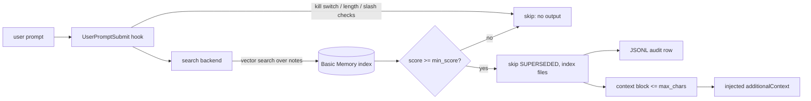

# agent-memory-recall

Prompt-time memory recall for coding agents. When a user submits a prompt, a hook searches a set of
Markdown notes by meaning and injects the top few matches as a short context block. The agent sees
the lesson it wrote down last month without being asked to look for it.

Parts:

- `memory-recall`: the hook, a CLI, and a read-only HTTP endpoint (stdlib only).
- `embed/`: an optional local embedding server (OpenAI-style `/v1/embeddings`) with an example systemd unit.
- `eval/`: a retrieval eval (hit@3, MRR@10) with a synthetic 40-note demo corpus and results.

## Architecture



The hook path uses a search backend that implements `search(project, query, k)`. The default backend is
Basic Memory over MCP. The embedding server is used by the eval's vector mode; the hook does not call it
directly.

## Design rules

- **Fail open.** Any error (backend down, bad JSON, parse failure) gives empty output and exit 0. A prompt is
  never blocked by recall.
- **Latency budget.** The search runs in a worker thread with a hard timeout (default 1.8 s). A slow backend
  returns nothing; the worker is left to finish and its result is dropped. The budget holds even if the backend
  ignores its own timeouts.
- **Cutoff.** Hits below `MEMORY_RECALL_MIN_SCORE` are dropped. The default 0.77 was calibrated for one model
  on one private corpus. Recalibrate it whenever the model or corpus changes (see `eval/RESULTS.md`).
- **Cap.** At most `k` hits, and the block is cut to `MEMORY_RECALL_MAX_CHARS` with an ellipsis. The footer is
  dropped first when space is short.
- **Superseded notes are never injected.** A note whose first body line starts with `SUPERSEDED` is skipped and the
  next hit fills the slot. A note starting with `UPDATE` is injected with a hint to open it.
- **Kill switch.** `MEMORY_RECALL_OFF=1` or the file at `MEMORY_RECALL_OFF_FILE` turns every mode into a no-op.
- **Audit log.** Every call appends one JSON line (time, surface, projects, query prefix, hits with scores, latency,
  error or skip reason) to `MEMORY_RECALL_LOG`. The log contains prompt text; treat it as private.
- **Vector, not hybrid.** The Basic Memory backend asks for `search_type: vector`. See the finding below.

## Quickstart: demo eval (no services needed)

Requires Python 3.12+ and [uv](https://docs.astral.sh/uv/).

```
uv sync --group dev
uv run pytest                          # unit tests, no network
uv run python eval/run_eval.py         # keyword (BM25) mode only, no server
```

Vector and fused modes need an embedding server with the same `/v1/embeddings` contract:

```
uv sync --extra embed                  # numpy, sentence-transformers, torch
EMBED_PORT=8790 uv run python embed/embed_server.py &
uv run python eval/run_eval.py --embed-url http://127.0.0.1:8790/v1/embeddings --verbose
```

`--json FILE` writes the per-query ranks and cosine stats. `eval/results/` is git-ignored.

## Using it with real notes

The hook needs a running Basic Memory MCP server (streamable HTTP) with your notes indexed. Basic Memory does
the indexing; this package only queries it. Setup is in the Basic Memory docs. Then point the hook at it:

```
export MEMORY_RECALL_MCP_URL=http://127.0.0.1:8791/mcp
export MEMORY_RECALL_PROJECTS="notes=$HOME/notes,runbooks=$HOME/runbooks"   # name=notes-dir
export MEMORY_RECALL_MIN_SCORE=0.77
```

`name` is the Basic Memory project name, and the path is the notes directory on disk (used to read frontmatter).

## Wiring the hook into Claude Code

Add to `~/.claude/settings.json` (or a project's `.claude/settings.json`). Use the absolute path to the
installed script:

```json
{
  "hooks": {
    "UserPromptSubmit": [
      {
        "hooks": [
          { "type": "command", "command": "/abs/path/to/agent-memory-recall/.venv/bin/memory-recall --hook" }
        ]
      }
    ]
  }
}
```

The hook reads the event on stdin and prints `hookSpecificOutput.additionalContext`. It prints nothing when
there is no hit. Shape checked against the Claude Code hooks docs cached for version 2.1.114.

To run the read-only endpoint instead (for a container or another host on a private network):

```
MEMORY_RECALL_SERVE_HOST=127.0.0.1 MEMORY_RECALL_SERVE_PORT=8792 memory-recall serve
curl 'http://127.0.0.1:8792/recall?project=notes&q=how+do+I+rotate+keys&k=3'
```

There is no authentication on the endpoint. Keep it on loopback or a private interface.

## Configuration

| Variable | Default | Meaning |
|---|---|---|
| `MEMORY_RECALL_MCP_URL` | `http://127.0.0.1:8791/mcp` | Basic Memory MCP endpoint |
| `MEMORY_RECALL_PROJECTS` | (none) | `name=path,...`; names are searched, paths read for frontmatter |
| `MEMORY_RECALL_SERVE_PROJECTS` | all | comma list the HTTP endpoint may answer for |
| `MEMORY_RECALL_SERVE_HOST` / `_PORT` | `127.0.0.1` / `8792` | endpoint bind address |
| `MEMORY_RECALL_TIMEOUT` | `1.8` | total budget per call, seconds |
| `MEMORY_RECALL_MIN_SCORE` | `0.77` | cutoff, inclusive |
| `MEMORY_RECALL_MAX_CHARS` | `600` | block size cap |
| `MEMORY_RECALL_MODEL_TAG` | `vector` | label shown in the block header |
| `MEMORY_RECALL_SKIP_FILES` | `MEMORY.md,index-*.md` | comma list of file-name globs never injected |
| `MEMORY_RECALL_LOG` | `$XDG_STATE_HOME/memory-recall/recall.jsonl` | audit log |
| `MEMORY_RECALL_OFF` / `MEMORY_RECALL_OFF_FILE` | unset / `…/memory-recall/off` | kill switch |

Embedding server (`embed/embed_server.py`): `EMBED_HOST` (127.0.0.1), `EMBED_PORT` (8790), `EMBED_MODEL`
(`google/embeddinggemma-2`), `EMBED_IDLE_TIMEOUT` (3600 s; the model unloads after this long idle),
`EMBED_DEFAULT_DIMS` (256). The example unit is `embed/memory-recall-embed.service`.

## Eval method

- Corpus: `eval/corpus/*.md`, one note per file; the file stem is the note id.
- Queries: `eval/queries.jsonl`, one JSON object per line: `{"q", "kind": "nl"|"kw", "expect": "<stem>"}`.
  Every note has exactly one query (checked by a test).
- Modes: **vector** (cosine over normalized embeddings, the same model and dimensions as the server), **keyword**
  (Okapi BM25, k1 1.5, b 0.75), **fused** (reciprocal-rank fusion, k=60, of vector and keyword).
- Metrics: hit@3 and MRR@10, in `eval/metrics.py` (unit-tested on a fixture).
- The demo corpus and queries were written for this repo. They are synthetic and small. They show the method,
  not a general ranking of retrieval systems.

## Results

Full tables in [`eval/RESULTS.md`](eval/RESULTS.md). Short version:

| | Private corpus, 30 NL queries (quoted) | Demo corpus, 40 queries (measured here) |
|---|---|---|
| vector hit@3 / MRR@10 | 0.800 / 0.698 | 0.975 / 0.950 |
| keyword hit@3 / MRR@10 | not run as a standalone mode | 0.875 / 0.834 |
| fused hit@3 / MRR@10 | not run | 0.950 / 0.915 |
| Basic Memory hybrid hit@3 / MRR@10 | 0.200 / 0.202 | not run |

The private row is a different corpus with a different model setup, so compare shapes, not values.

### Finding: vector beat Basic Memory's hybrid mode

On the private corpus, Basic Memory's hybrid mode ranked like its full-text search and scored well below
vector search (hit@3 0.200 vs 0.800). Its score fusion puts the full-text top hit at 1.0, and the embedding
cosines it competes with stay below that, so the vector signal never reorders results. The author switched
the backend to vector-only. This is reported from the author's measurements; the mechanism is an inference
from the fusion formula and score ranges (see `eval/RESULTS.md`). The demo corpus does not reproduce the hybrid
comparison because the reference fusion here is RRF, not Basic Memory's formula.

### Cutoff calibration

The 0.77 cutoff was fitted to one model and corpus. On the demo corpus it drops 5 of 40 correct notes and
still admits off-target notes for 16 of 40 queries. Calibrate on your own corpus before trusting the hook's
silence or its hits.

## Tests

`uv run pytest`. Covers fail-open paths, the latency budget (a slow fake backend returns within budget), the
min-score and max-chars cuts, superseded and index-file skipping, the kill switch (env and file), JSONL rows,
hook input filtering, config parsing, and eval metric math. The fake backend means no network is used.
The embedding server is not covered by tests.

## Limits and what is not verified

- No end-to-end hit has been produced by this repo's code against a live Basic Memory server. The one run
  against the author's live server returned "Project not found" (no project of that name), which exercised
  the fail-open path only. The unit tests use a fake backend. The MCP client is minimal and follows the
  streamable-HTTP handshake of the server version the author runs; other versions are untested.
- The embedding server was exercised on the author's machine (GPU, `google/embeddinggemma-2`). CI does not
  install the `embed` extra or run it.
- The demo results are one run on one synthetic corpus.
- Basic Memory is an external project and is not included. Indexing and vector storage are its job.
- Per-project path lookup assumes notes are plain Markdown files with optional YAML frontmatter.

## License

Apache License 2.0. See [LICENSE](LICENSE).
